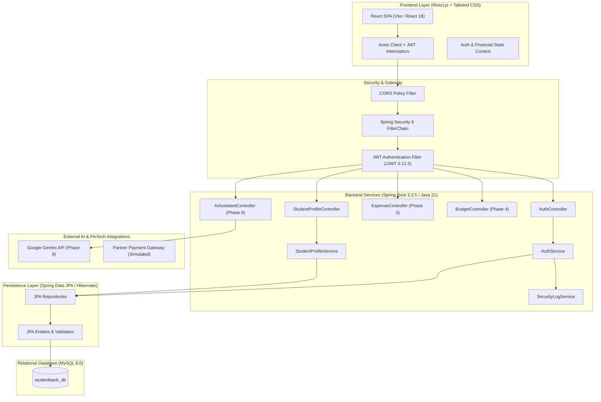

# StudentBank – Architecture & Technical Blueprint

## 1. System Overview & Architecture

**StudentBank** is an enterprise-grade student financial management platform designed for college and university students across India.

---

## 2. Entity-Relationship (ER) Architecture

The platform architecture features 19 normalized relational tables:
1. `users` (Central identity & auth table)
2. `student_profiles` (University, college, course, department, year, allowance)
3. `accounts` (Simulated digital wallet, UPI ID, QR token, spend caps)
4. `transactions` (Income, expenses, payment modes, merchant info)
5. `expense_categories` (System and custom student categories)
6. `monthly_budgets` (Category-wise monthly caps & alert threshold)
7. `savings_goals` (Goal vaults, target dates, monthly installment plans)
8. `scholarships` (National, private, and AICTE schemes)
9. `scholarship_applications` (Submission tracking, document checklist)
10. `fee_reminders` (Tuition, hostel, mess, exam fee tracking)
11. `notifications` (System and budget threshold alerts)
12. `financial_challenges` (Gamified 30-day savings challenges)
13. `chat_history` (AI queries, intent detection, advice logs)
14. `student_rewards` (Badges, cashbacks, achievement points)
15. `security_logs` (IP, User-Agent, event audit logging)
16. `subscriptions` (Student SaaS & media subscriptions)
17. `shared_expenses` (Roommate & group bill splitters)
18. `payments` (Simulated mock UPI gateway transactions)
19. `admin_users` (Platform administrators & moderation)

---

## 3. Security Highlights

- **Stateless Authentication**: JJWT HMAC-SHA256 tokens with 24-hour expiration.
- **Password Protection**: BCrypt salted password hashing.
- **Data Isolation**: Student endpoints bind strictly to `SecurityContextHolder.getContext().getAuthentication()`.
- **CORS Configuration**: Supports cross-origin requests from Vite development servers.
- **Audit Logging**: All registration, login, and reset actions are logged to `security_logs`.
